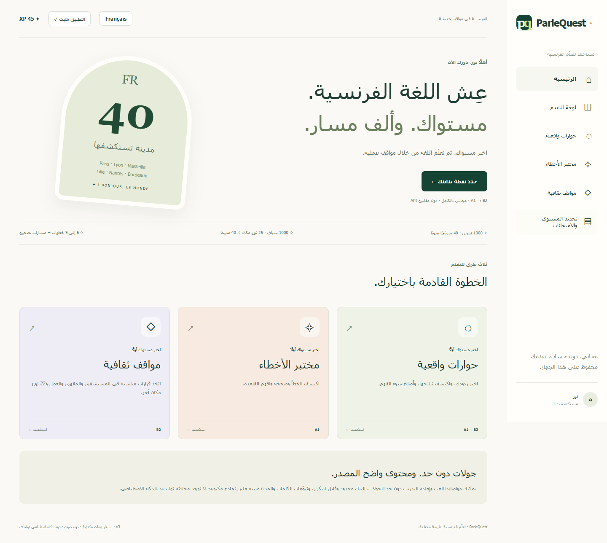

<div align="center">

# ParleQuest
### Apprendre le français autrement

A free Arabic–French learning experience that connects grammar, conversation and everyday communication.

[**Try the live app →**](https://parlequest.pages.dev/) · [العربية](docs/README-AR.md) · [Academic overview · Français](docs/ACADEMIC-FR.md) · [Content & validation](docs/CONTENT-AND-VALIDATION.md)




</div>

## Why ParleQuest?

Knowing a rule and using it in a real conversation are different skills. ParleQuest brings both into one browser-based learning space: notice an error, understand the feedback, choose a response, and see what happens next.

The app is designed for learners who benefit from Arabic guidance while practising French. It works without an account or a paid API, stores progress on the learner’s device, and can be added to the home screen where the browser supports installation.

## Three ways to practise

| Experience | What learners do |
| --- | --- |
| **Parle Vrai** | Follow branching conversations, choose replies and repair misunderstandings. |
| **ErreurLab** | Identify a grammatical error, write the correction and read a French/Arabic explanation. |
| **CultureQuest** | Make contextual communication decisions in administrative, educational, workplace and everyday settings. |

Each experience has an independent **A1, A2, B1 or B2** level selector. A short internal grammar check can suggest a starting path. A resources section links to TV5MONDE practice and official DELF sample-paper pages.

## What is included?

- **1,000 grammar exercises:** 250 per level, built from **40 grammatical models × 25 lexical variants**.
- **1,000 contextual locations:** **25 setting types × 40 French cities**, with shared scenario templates and context-specific comprehension details.
- **6–9 main decisions per scenario**, depending on level, with additional repair branches.
- Arabic and French interfaces, RTL/LTR layouts and bilingual learning feedback.
- A first-visit name prompt, local progress, first-attempt points and targeted revision suggestions.
- Repeatable practice sessions, searchable scenario libraries and a JSON progress export.
- A PWA manifest, icons, offline asset caching after an initial successful load, and device-specific installation guidance.

**Content is finite and transparent.** Unlimited sessions mean repeatable practice, not infinitely many unique questions. Cities are real; institutions, rooms, references and appointment details in the simulations are fictional. The level labels are pedagogical estimates, not validated CEFR certification. The internal check covers grammar only.

**This is not generative AI.** Conversations are authored decision graphs, corrections use accepted answers, and revision suggestions use recorded error categories. There is no speech recording or audio feature in this release.

## Run locally

Use **Node.js 22.12+** and npm:

```sh
git clone https://github.com/KhaledAbouElnaga/parlequest.git
cd parlequest
npm ci
npm run dev
```

Build and verify the complete app:

```sh
npm run build
npm test
npm run preview
```

The build regenerates the question bank, runs strict TypeScript checking, builds the static app, and generates the service worker. Run the build before the tests: PWA checks inspect the generated files in `dist/`.

No `.env` file or API key is needed to run the application. An internet connection is needed to install dependencies; the deployed application does not call an AI or translation service.

## Architecture

```text
src/
  main.tsx                 Application, navigation, profiles and installation UI
  world.ts                 Cities, setting templates and level-specific dialogue graphs
  learning.js              Profiles, next-item selection and internal diagnostic
  engine.js                Answer normalization, first-attempt scoring and persistence
  grammar-bank.json        Generated, inspectable exercise bank
scripts/
  generate-content.mjs     Source models and lexical data for the 1,000 exercises
  offline.mjs              Production offline-cache generation
tests/                     Scoring, corpus, graphs, localization and PWA checks
public/                    Manifest and application icons
docs/                      Arabic guide, academic framing, deployment and screenshots
.github/workflows/         Build/test checks and optional Cloudflare deployment
```

Legacy content/localization fixtures are retained in `src/` and tested as regression fixtures; the active v3 application uses `world.ts` and the generated grammar bank.

## Privacy and progress

There is no application backend or account system. The display name, chosen levels, scores and active run stay in the browser’s local storage. They do **not** automatically sync between devices. Clearing site data removes them. Do not enter real medical, immigration, financial or other sensitive information into the learning scenarios.

## Quality and limits

The current suite contains **20 automated checks**, including exact corpus counts, unique questions, level distribution, graph termination, profile validation and simulated PWA caching. The production UI was also tested in an isolated browser at desktop and mobile widths; installation events and storage were mocked in that test. Live-site checks covered onboarding, level selection, correction, saved progress and scenario filters.

Installation on physical devices and effectiveness with learners have not been certified. A FLE teacher’s review and learner testing remain part of the next phase. See [content and validation](docs/CONTENT-AND-VALIDATION.md) and the [French academic brief](docs/ACADEMIC-FR.md).

## Deployment and future updates

The live site is hosted on **Cloudflare Pages**. The existing project was created through Direct Upload. This repository includes:

- automatic build and test checks on pushes and pull requests;
- an optional deployment job that publishes successful `main` builds to the existing `parlequest` Pages project once its credentials and enable flag are configured.

Creating the workflow alone does **not** connect production. See [deployment setup](docs/DEPLOYMENT.md) for the exact enablement steps and status. Cloudflare tokens belong in GitHub Actions secrets, never in source files.

## Roadmap

- Teacher review, item calibration and broader learner testing.
- More independently authored scenario families and deeper level differentiation.
- Accessibility and physical-device PWA testing.
- Optional accounts, cross-device progress and a teacher dashboard.

## Contributing

Ideas, language corrections and bug reports are welcome. Read [CONTRIBUTING.md](CONTRIBUTING.md) before making changes, especially the guidance on linguistic accuracy, cultural nuance and learner data.

Maintained by [Khaled AbouElnaga](https://github.com/KhaledAbouElnaga).
