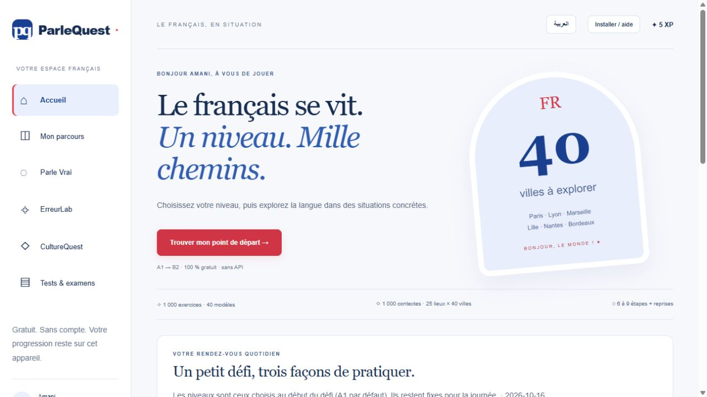

# ParleQuest
### Apprendre le français autrement

A French-learning web app with French and Arabic interfaces, authored branching conversations, grammar exercises and cultural decisions.

[Open the protected app](https://parlequest.pages.dev/) · [Access-control deployment](docs/ACCESS-CONTROL.md) · [Academic overview](docs/ACADEMIC-FR.md)



## Access

The hosted app is becoming invite-only. Approved users sign in with a username and password. New users can request access; the owner approves, rejects or suspends them in `/admin`. Single-use activation links let invited users set their own passwords. Usernames resembling email addresses do not create mailboxes. The current version does not send email notifications or password-reset emails.

Every application route and exercise bundle passes through a Cloudflare Pages authorization worker, backed by a dedicated D1 database. Production must use **Fail closed**, a server-only encrypted `AUTH_PEPPER`, and the `AUTH_DB` binding. Missing configuration denies access. Do not publish a static-only build or roll back to an unauthenticated deployment. Older public deployments must be removed after the protected version is verified.

There are no production credentials, identities or activation links in this repository. The source remains public; site access controls cannot retract previously published source or downloaded copies.

## Learning features

- Parle Vrai: authored branching conversations with feedback and repair paths.
- ErreurLab: 1,000 exercises (40 grammar models × 25 lexical variants), 250 per level, A1–B2.
- CultureQuest: 1,000 contextual locations (25 settings × 40 cities), based on shared authored templates.
- Daily grammar, dialogue and culture challenge with saved completion.
- Scheduled grammar review after 1, 3, 7 and 14 days following successful reviews; errors return after 10 minutes.
- Nine additional contextual decisions for university, café and railway-station scenarios at A2–B2.
- Indicative 20-question grammar diagnostic and links to official external practice resources.

This is not generative AI. Level labels are pedagogical estimates, not certification. Institutions, references and appointment details are fictional. External FLE teacher review remains pending.

## Progress and connectivity

Progress is stored in browser storage, separately for each signed-in account. It does not automatically sync between devices. Old anonymous progress is not silently assigned to a new user. Private access requires connectivity: the earlier offline cache is retired to prevent it from bypassing authentication. The app can still be added to the home screen where the browser supports it.

## Development and deployment

Use Node.js 22.13+ (Node 24 is also supported):

```sh
npm ci
npm run build
npm test
```

The build generates the exercise corpus, checks TypeScript, builds the UI and installs the advanced-mode authorization worker for every route. Tests use a disposable in-memory SQLite database, not production data. Vite's static preview alone does not emulate authentication; use Wrangler Pages with a local D1 binding for authenticated development. See [the access deployment guide](docs/ACCESS-CONTROL.md).

GitHub Actions verifies main and pull requests. Successful main builds deploy the existing Cloudflare Pages project when its enable variable and deployment secrets are configured. The deployment token expires on **14 January 2027** and must be rotated before expiry.

The current suite contains **29 automated checks**, including authorization, role enforcement, pending accounts, invitation expiry/reuse, CSRF, credential overwrite prevention, revocation, rate limiting, corpus counts, scenario termination and review scheduling.

The older Arabic user guide predates private access; its anonymous/offline instructions should not be redistributed as current instructions.

Maintained by [Khaled AbouElnaga](https://github.com/KhaledAbouElnaga).